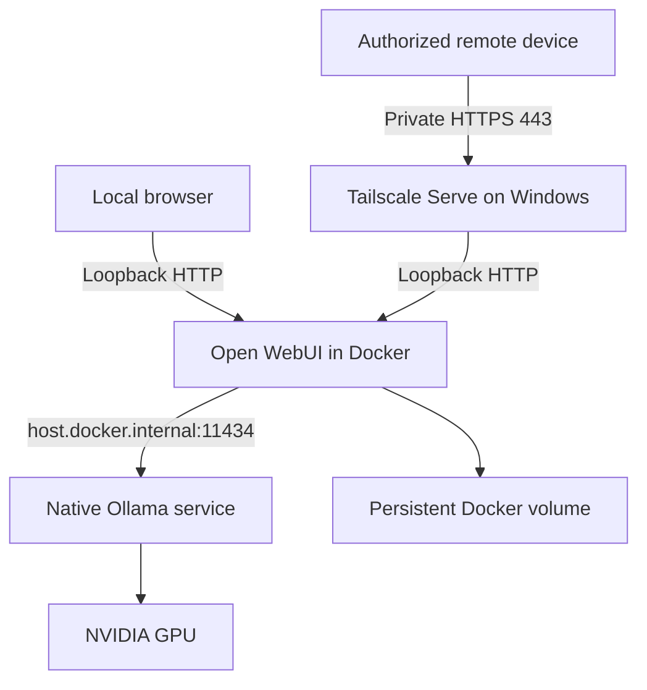

# Local AI Deployment on Windows

A documented deployment of native Windows Ollama, GPU inference, Docker-hosted
Open WebUI, and private HTTPS access through Tailscale Serve.

**Status: core isolated-deployment checks passed on the reference Windows host.**
On October 31, 2026, the owner confirmed API checks, browser generation, absence of
a signup option, and chat persistence after container recreation. The test reuses
an existing Ollama service. Owner-supplied `ollama ps` confirms 100% GPU placement
for Qwen3:8b with a 4,096-token context. Remote-access testing, reboot testing of
the new deployment, and fresh-machine validation remain pending.
See [the validation record](docs/validation.md).

## Contribution

Alessandro Condina configured and integrated the original system, investigated
networking and service startup, and measured inference throughput. This repository
packages that configuration with AI-assisted scripts and documentation. Ollama,
Open WebUI, Docker, Tailscale and the model are third-party projects. This project
does not train models or implement an inference engine.

## Architecture



Ollama runs as an automatic Windows service through NSSM. Docker Desktop starts
after the user signs into Windows. The complete WebUI experience therefore becomes
available after sign-in, matching the reference system. This is startup behaviour,
not a security guarantee that signing out stops inference or remote access.

## Reference environment

| Component | Owner-reported configuration |
|---|---|
| OS | Windows 11; build 10.0.26300.9818 |
| CPU / GPU | Ryzen 9 5900X / RTX 5070, 12,227 MiB VRAM |
| NVIDIA driver | 610.88 |
| Docker Desktop / Engine | 4.81.0 / 29.6.1 |
| Compose | 5.2.0 |
| WSL | 2.7.10.0 |
| Ollama | 0.32.1 |
| Tailscale | 1.102.2 |
| NSSM | 2.24, 64-bit |
| Model | qwen3:8b, Q4_K_M, 8.2B parameters |
| Model ID prefix | 500a1f067a9f |

The Compose file pins the owner-reported Open WebUI image digest. Registry
availability has not been verified here. Model tags can change; compare `ollama list`
with the recorded ID before claiming identical model reproduction. The reported
40,960-token model context capability is not a measured active context setting.

## Prerequisites on a fresh Windows PC

1. Install an appropriate NVIDIA driver, enable hardware virtualization, install
   WSL2, and install Docker Desktop using its WSL2/Linux-container backend.
2. Enable Docker Desktop's startup when you sign in. Do not configure Windows auto-login.
3. Install Ollama for Windows and confirm `ollama --version` works.
4. Configure the NSSM service using [the service guide](docs/windows-service.md).
   On the existing reference PC, reuse its running service instead.
5. Run `ollama pull qwen3:8b`, then `ollama list`. Downloads need internet access.
6. Install Tailscale and sign into your own tailnet when ready for remote access.

Use official installers, not binaries copied from this repository. The reference
versions above record the observed system; compatibility with other versions must
be tested. GPU memory needs depend on model, context and concurrent requests.

## Isolated trial on the reference PC

This package defaults to project `local-ai-test`, port **8089**, and its own
`local-ai-test_webui-data` volume. It does not reuse the existing `open-webui`
container, port 8088, or conversation database. It shares the running Ollama server,
so simultaneous generations may compete for GPU resources.

Extract the package and open PowerShell in its root directory:

```powershell
Copy-Item .env.example .env
.\scripts\Start-WebUI.ps1 -Bootstrap
```

If local script policy blocks execution, review the scripts and use an approved
execution method for your machine; no system-wide policy changes are required by
this package. Wait for the container to become healthy (`docker compose ps`).
Open http://127.0.0.1:8089 on the host and create the first administrator account.
Keep remote forwarding disabled during this initial bootstrap.

Then disable signup explicitly:

```powershell
.\scripts\Start-WebUI.ps1
.\scripts\Test-Setup.ps1 -Generate
```

Log in through the browser, select Qwen3 and generate a response. Verify that
signups are disabled and authentication remains required. `ENABLE_PERSISTENT_CONFIG`
is false so configuration comes from Compose rather than inherited database
settings; make managed changes in Compose, not only in the admin interface.
The volume still preserves accounts and conversations. OpenAI API integration is
disabled for this local-only package.

If the container cannot reach Ollama, follow the network section in the service
guide. Do not blindly expose port 11434 to every interface.

## Private remote access

See [private access](docs/private-access.md). Only configure forwarding after the
administrator exists and signup is disabled. Do not redirect your current 8088
Serve route during the isolated local test.

## Validation and benchmarking

Complete [the validation checklist](docs/validation.md). Run:

```powershell
.\scripts\Benchmark.ps1 -Runs 3
```

This records a warmup and measured generations as local JSON, excluded from Git.
Generation throughput is eval_count / (eval_duration / 1e9); it excludes model
loading and prompt processing. Total duration is reported separately. Record GPU
use with `ollama ps` and `nvidia-smi` during inference. A response alone does not
prove GPU execution.

Historical owner-provided result, July 13, 2026: Qwen3:8b on RTX 5070 generated
3,052 tokens at 105.14 tokens/s, with total request duration 31.59 s. This was one
run with incomplete version/context/warmup metadata. It is not a guaranteed speed
or a result from this package. The new script uses explicit options and a token
limit, so its results are not directly identical to that historical experiment.

## Stop, update and recovery

`docker compose stop` stops this project's container. `docker compose down` removes
its container/network but preserves the volume. Do not use `down -v` unless you
intend to delete its accounts and chats. Back up data before changing image versions.
A restart policy does not start Docker Desktop before login. No Docker-wide removal
or cleanup script is included.

For a permanent deployment, choose a new Compose project name with `-p` consistently
and a free port; changing the project name also selects a different volume. Do not
reuse the existing volume without a separate backup and migration plan.

## Repository hygiene

Keep `.env`, passwords, model weights, chat databases, and private hostnames out of
Git. Review changes before committing. This repository remains private while the
package is validated. Upstream tools and models retain their own licenses; the
owner has not yet selected a license for this package.

## Sources

- https://docs.openwebui.com/reference/env-configuration/
- https://docs.openwebui.com/getting-started/quick-start/
- https://docs.ollama.com/faq
- https://www.nssm.cc/usage
- https://tailscale.com/docs/reference/tailscale-cli/serve
- https://docs.docker.com/compose/
